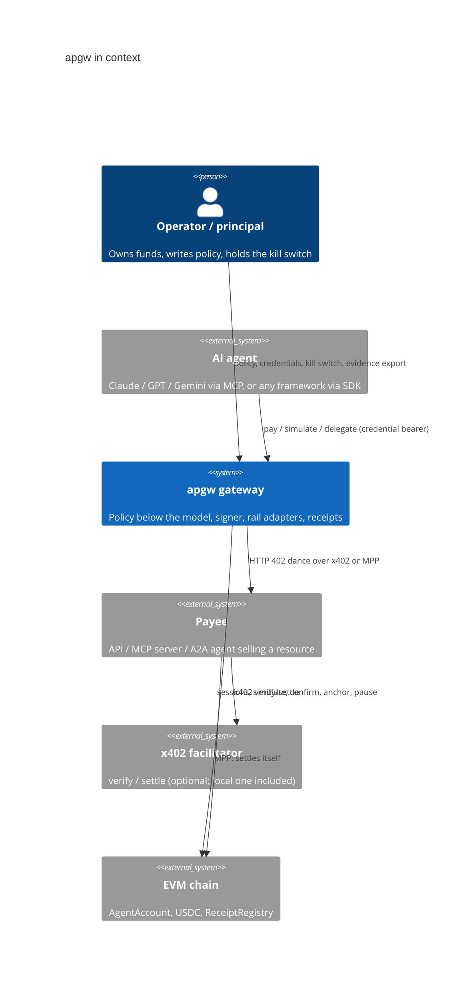
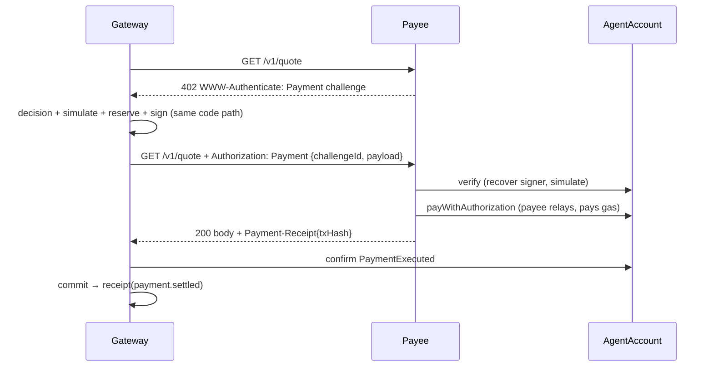
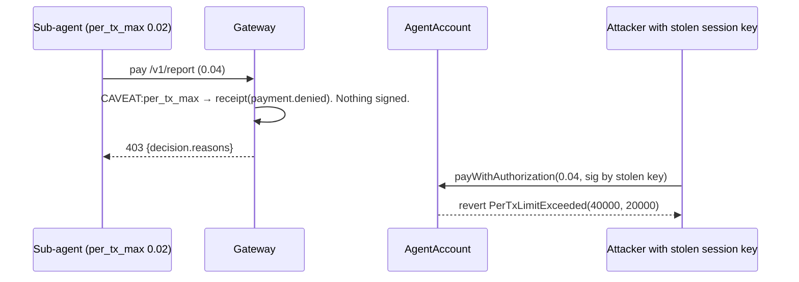
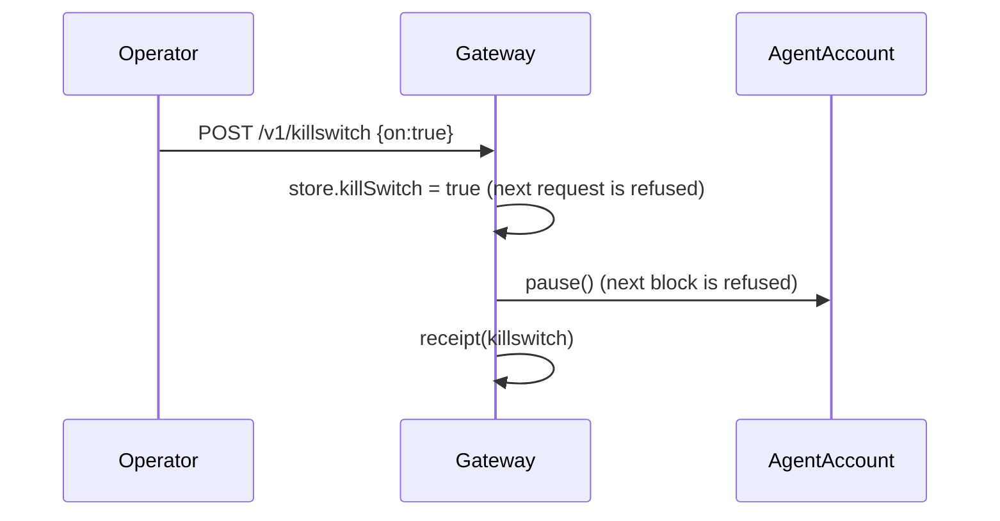

# Architecture (Phase 0)

## Context



## Containers

```mermaid
flowchart LR
  subgraph Agent side
    A[Agent / MCP client] -->|SDK: pay()| GW
  end
  subgraph apgw gateway
    GW[HTTP API] --> POL[Policy engine<br/>deny rules → caveats → lineage caps → budgets → escalate → allow]
    GW --> CRED[Credential service<br/>HMAC chain, attenuation, register → on-chain session]
    GW --> PAY[Payment service<br/>pre-check → 402 quote → binding decision → simulate → reserve → sign → confirm → commit]
    PAY --> SIG[Signer<br/>gateway key + derived session keys<br/>swap for KMS/HSM/MPC]
    PAY --> RAILS[Rail adapters<br/>x402 client · MPP client]
    GW --> RCPT[Receipt log<br/>hash chain, EIP-191 signed]
    GW --> FAC[Local x402 facilitator<br/>/verify /settle]
    RCPT --> STORE[(Store<br/>JSON write-through)]
  end
  subgraph Payee
    MW[paid() middleware<br/>x402 + MPP in one block] --> RES[Resource handler]
  end
  subgraph Chain
    ACC[AgentAccount<br/>sessions · enforcers · pause]
    USDC[MockUSDC<br/>EIP-3009]
    REG[ReceiptRegistry]
  end
  RAILS -->|402 / paid retry| MW
  MW -->|x402| FAC
  MW -->|MPP| ACC
  FAC --> ACC
  ACC --> USDC
  PAY -->|simulate / confirm| ACC
  GW -->|anchor| REG
```

## The canonical objects

* **PaymentIntent** — what the agent wants: payee URL, resource, `maxAmount`, purpose, rail preference. Rails never see anything else. Its hash is written into the on-chain `PaymentAuthorization.intentHash`, binding evidence to settlement.
* **Credential** — a macaroon-style bearer token: `sig_0 = HMAC(root, rootId)`, `sig_i = HMAC(sig_{i-1}, caveat_i)`. Anyone can append caveats offline; nobody can remove one. A `delegate` caveat names a sub-agent. The effective limit is the conjunction of every caveat, so a child is always a subset of its parent (property-tested, 500 runs).
* **Session** — the on-chain compilation of a credential's effective limits: `spendCap`, `perTxMax`, `validAfter/Until`, target and token allowlists, keyed by a session key derived from the credential id. `grantChildSession` re-checks subset-ness on-chain.
* **Receipt** — one per decision, settlement, denial, credential event, kill-switch flip, anchor. Hash-chained per principal and signed by the gateway key; verifiable with nothing but the gateway address.
* **EvidenceBundle** — policy + hash, public credentials, receipt chain, anchors. `verifyBundle()` runs offline; `--rpc` adds anchor existence.

## Sequences

### Pay per call over x402

```mermaid
sequenceDiagram
  participant Ag as Agent
  participant GW as Gateway
  participant P as Payee
  participant F as Facilitator
  participant C as AgentAccount
  Ag->>GW: POST /v1/intents {url, maxAmount, purpose, rail:x402}
  GW->>GW: decision(precheck on maxAmount) → receipt
  GW->>P: GET /v1/quote
  P-->>GW: 402 PAYMENT-REQUIRED (+ WWW-Authenticate: Payment)
  GW->>GW: decision(quoted amount, payTo, rail) → receipt
  GW->>C: simulate(auth, sessionKey)
  C-->>GW: ok
  GW->>GW: reserve budgets; sign EIP-712 PaymentAuthorization with session key
  GW->>P: GET /v1/quote + PAYMENT-SIGNATURE
  P->>F: /verify
  F->>C: simulate
  P->>F: /settle
  F->>C: payWithAuthorization → USDC.transfer(payee)
  P-->>GW: 200 body + PAYMENT-RESPONSE{tx}
  GW->>C: confirm tx has PaymentExecuted(intentHash, amount, to)
  GW->>GW: commit budgets → receipt(payment.settled)
  GW-->>Ag: {ok, body, settlement, receipts}
```

### Same resource over MPP (identical agent call, rail:mpp)



### Denial, twice independently



### Kill switch



## Trust boundaries

| Component | Holds | Can lose at most |
|---|---|---|
| Model / agent framework | a credential (bearer, attenuable) | nothing: it cannot sign; the gateway decides |
| Gateway | gateway key, session-key secret, credential root key | up to the on-chain caveats of any session (chain is the backstop) |
| Session key (derived) | nothing stored | its own `perTxMax` × remaining `spendCap`, only to allowlisted targets, only until `validUntil` |
| Facilitator | nothing | nothing: it can refuse to settle, not steal; the gateway confirms on-chain |
| Payee | relayer key (gas only) | gas |
| AgentAccount owner | owner key | everything (by design: the principal) |

## What Phase 0 deliberately simplifies

* Store is a JSON file; interface is what Postgres replaces.
* Gateway key owns the AgentAccount (dev). Production: principal's wallet owns it, gateway is granted an operator role.
* `AgentAccount` is deployed standalone; it is EIP-7702-shaped (`initialize`, no constructor-only state) and the 7702 delegation path is Phase 1.
* x402 is implemented with the `exact` scheme and an `agent-account` payload kind; the standard EIP-3009 kind is accepted by the facilitator for plain EOAs but not used by the demo.
* MPP is implemented at the challenge/credential/receipt shape of the IETF draft for a single method; subscriptions and streaming are Phase 2.
* Budgets are lifetime caps; periods (daily/monthly) are Phase 1.
* Escalation produces a decision but there is no approval workflow yet.
